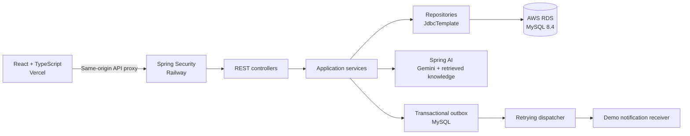

# TutorConnect

A full-stack tutoring platform with an AI scheduling assistant and transaction-safe reservations. Customers find and book sessions; providers manage availability and appointments. Both the booking form and the assistant use the same backend rules to prevent double-booking.

[Live demo](https://tutorconnect-psi.vercel.app) · [Architecture](#architecture) · [Engineering decisions](#engineering-decisions) · [Run locally](#run-locally) · [Verification](#verification) · [Deployment guide](deploy/README.md)

Built with **React, TypeScript, Spring Boot, Spring AI and MySQL**, deployed across **Vercel, Railway and AWS RDS**. This branch, `react-rds-upgrade`, contains the React frontend and cloud deployment work.

## Try the demo

Browse available sessions, sign in as a customer, and book a session. In the AI assistant, try “Find my next session” or ask about the cancellation policy. Review an AI booking proposal and explicitly confirm it before an appointment is created. Sign in as a provider to manage availability and view appointments.

| Role | Email | Password |
| --- | --- | --- |
| Customer | maya.patel@example.com | TutorDemo123! |
| Customer | sam.rivera@example.com | TutorDemo123! |
| Provider | priya.shah@example.com | TutorDemo123! |
| Provider | jordan.lee@example.com | TutorDemo123! |

These are public demo accounts with shared data. All appointment times use UTC. If the available dates have passed, a provider can add a future slot.

## What it does

| Workflow | Implementation |
| --- | --- |
| Customer booking | Browse sessions, book an available slot, view confirmations and cancel an owned future appointment. |
| Provider workspace | Create availability with service ownership, duration and overlap checks; deactivate or restore eligible slots; view appointments. |
| AI assistant | Search availability, look up appointments, answer policy questions from retrieved knowledge passages, and propose bookings or cancellations for confirmation. |
| Conversation history | Save chat transcripts in MySQL and let customers read their own history without replacing the active conversation. |
| Study reminders | Generate reminders for upcoming appointments and queue delivery through a transactional outbox. The current notification receiver is a demo sink. |

## Architecture



The frontend proxies `/api`, `/login` and `/logout` through its own origin. Spring Security authenticates the session before controllers call the service layer. Repositories execute parameterized SQL through `JdbcTemplate`; DTOs return application data to React. No ORM is used.

| Layer | Technologies |
| --- | --- |
| Frontend | React 19, TypeScript, Vite, React Router |
| Backend | Java 17, Spring Boot 4.1.1, Spring Security |
| AI | Spring AI 2.0.2, Gemini chat and embeddings, SimpleVectorStore |
| Persistence | MySQL 8.4, JdbcTemplate; H2 for disposable demos and tests |
| Deployment | Vercel, Railway, AWS RDS, Docker |
| Verification | JUnit, Spring Boot integration tests, Vitest, Node.js test runner |

## Engineering decisions

### One reservation per slot, including concurrent requests

Two customers can see the same available slot before either submits a booking. The booking transaction locks the existing slot row with `SELECT … FOR UPDATE` at `READ_COMMITTED`, then checks availability again. A second transaction waits for that row and sees the first customer's committed booking before it can insert.

MySQL also enforces a unique generated `active_slot_id` for `BOOKED` and `COMPLETED` appointments. Cancellation preserves the appointment record and releases that key; a later booking creates a new record. A failed transaction rolls back the appointment and its notification event together.

Transient lock failures receive at most three attempts, each through a separate transactional bean so the retry gets a fresh transaction. An occupied slot returns `409 Conflict` without retry; exhausted transient failures return `503 Service Unavailable`.

Explore [BookingTransaction](src/main/java/com/example/tutorconnect/service/BookingTransaction.java), [AppointmentService](src/main/java/com/example/tutorconnect/service/AppointmentService.java) and the [MySQL schema](src/main/resources/schema-mysql.sql).

### AI proposes an action; the customer authorizes it

The assistant calls service-backed tools to read availability and prepare a booking or cancellation proposal. A write requires an explicit confirmation with a session-bound, single-use token that expires after five minutes. The server checks the role, ownership and current availability again, then calls the same transactional service used by ordinary bookings.

Policy answers retrieve relevant passages from the project's knowledge file using Gemini embeddings. Saved transcripts are scoped to their owner. Tool execution is bounded to eight model rounds and ten tool calls per turn.

Explore [AiChatService](src/main/java/com/example/tutorconnect/ai/AiChatService.java), [AiConversation](src/main/java/com/example/tutorconnect/ai/AiConversation.java), [AiKnowledgeService](src/main/java/com/example/tutorconnect/ai/AiKnowledgeService.java) and the [knowledge files](src/main/resources/knowledge).

### Notification failures can be recovered after a booking commits

Booking and cancellation events enter an outbox in the same database transaction as the appointment change. Delivery happens after commit, so an unavailable notification receiver does not undo a successful reservation. The dispatcher uses bounded retries and stable event IDs for receiver-side deduplication; a recovery worker revisits pending events.

Explore the [notification dispatcher](src/main/java/com/example/tutorconnect/notification/NotificationDispatcher.java) and [recovery tests](src/test/java/com/example/tutorconnect/NotificationRecoveryTests.java).

### Authentication and secrets stay on the backend

Spring Security loads accounts through JDBC, checks BCrypt password hashes, and enforces customer/provider routes. Customer IDs come from the authenticated principal. Owner-only checks protect appointments and chat history. React uses an HttpOnly session cookie and CSRF headers, refreshing the CSRF token after login and logout.

The cloud database connection verifies the RDS TLS certificate and hostname. The application uses a dedicated database user; database credentials and Gemini keys are kept out of the frontend bundle and Git.

Explore [SecurityConfig](src/main/java/com/example/tutorconnect/security/SecurityConfig.java) and the [deployment configuration](deploy/README.md).

## Run locally

Requirements: **JDK 17, Maven and Node.js 24**. Docker is optional for the H2 demo and required for the Compose MySQL setup.

```sh
git clone --branch react-rds-upgrade https://github.com/Lushangtu123/CMPE-172-Milestone.git
cd CMPE-172-Milestone
mvn spring-boot:run -Dspring-boot.run.profiles=demo
```

In a second terminal, from the repository root:

```sh
cd frontend
npm ci
npm run dev
```

Open [http://127.0.0.1:5173](http://127.0.0.1:5173). Vite proxies backend requests to port `8080`. To use another backend port, set `API_PROXY_TARGET` in `frontend/.env.local`.

The `demo` profile seeds disposable H2 data. Booking works without an AI key. To enable Gemini, set these variables in the backend terminal before starting it:

```sh
export AI_ENABLED=true
export GEMINI_API_KEY='your-key'
export GEMINI_CHAT_MODEL='gemini-3.1-flash-lite'
export GEMINI_EMBEDDING_MODEL='gemini-embedding-001'
```

Choose a chat model available to your Google AI Studio account. A local `.env` file is read by Docker Compose; Maven does not load it automatically.

For persistent local MySQL, use this command instead of the H2 backend command, then start the React frontend as above:

```sh
docker compose up -d --build --wait
```

Compose exposes the backend on `8080` and MySQL on `3307`. Its database volume preserves data across restarts. The original Thymeleaf frontend remains available directly on the backend. See the [deployment guide](deploy/README.md) for RDS initialization, Railway variables and Vercel routing.

## Verification

The latest local verification completed **92 Java tests on H2**, the same **92 tests on MySQL 8.4**, **3 React API-client tests**, and **4 legacy assistant JavaScript tests**, all passing. The frontend also passed its TypeScript check and production build. These are local results, not a claim about hosted CI status or load capacity.

Run the H2 suite from the repository root:

```sh
mvn verify
node --test scripts/tests/assistant.test.cjs
```

Run the React checks from `frontend`:

```sh
npm test
npm run build
```

For MySQL verification, start the local database and prepare the dedicated test database:

```sh
docker compose up -d --wait db
docker compose exec -T db mysql -uroot -proot-demo-only -e "CREATE DATABASE IF NOT EXISTS tutorconnect_test; GRANT ALL PRIVILEGES ON tutorconnect_test.* TO 'tutorconnect'@'%';"
./scripts/test-mysql.sh
```

The MySQL test profile resets its data. The script rejects database names other than `tutorconnect_test`; use a dedicated local test database, never the deployed application database. If local credentials differ from Compose defaults, set `TEST_DB_USERNAME` and `TEST_DB_PASSWORD`.

Tests worth reading:

- [BookingWorkflowTests](src/test/java/com/example/tutorconnect/BookingWorkflowTests.java): two authenticated sessions synchronize concurrent requests with latches; exactly one booking returns `201`, the other returns `409`, and the database contains one active appointment.
- [AiWorkflowTests](src/test/java/com/example/tutorconnect/AiWorkflowTests.java): confirmation, ownership and AI booking conflicts, including concurrent attempts.
- [TransactionTests](src/test/java/com/example/tutorconnect/TransactionTests.java): rollback behavior and the database uniqueness backstop.
- [SpaApiTests](src/test/java/com/example/tutorconnect/SpaApiTests.java): session responses, JSON authentication and role-scoped API data.

## Current scope

TutorConnect is a portfolio demo developed from a CMPE 172 course project. It uses public demo accounts and a mock notification receiver; it does not send real email or offer school SSO. Authentication sessions, active AI context and pending confirmations are held in memory, so the deployment uses one backend replica. Restarting the backend signs users out and discards unconfirmed proposals; appointments and saved chat history remain in MySQL.

The [deployment guide](deploy/README.md) documents the infrastructure setup and current operational limits, including RDS network allowlisting.
