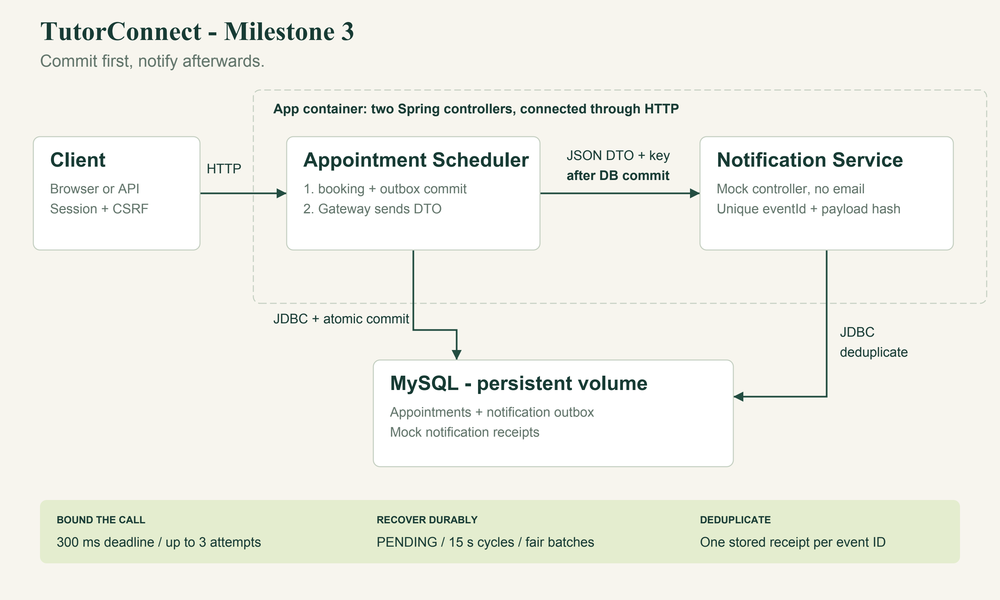

# TutorConnect Milestone 3 report

Integration distribution and deployment

Yinqi Chen | CMPE 172 | October 18, 2026

## 1 Distribution boundary and interface

TutorConnect sends booking and cancellation notifications after the appointment transaction commits. If the notification service is slow or unavailable, the appointment still succeeds and a database outbox keeps the event for another attempt. This milestone adds that HTTP integration to the existing JDBC scheduler, along with logging, health checks, metrics, Docker deployment and CI. Customers keep using the original interface with session authentication.



NotificationGateway makes the HTTP call from the Appointment Scheduler to the Notification Service. The mock service is a second Spring controller in the same app container, which the assignment permits. The dotted boundary in the diagram shows this shared deployment. There is no separate notification container.

### One request for each notification

```
public record NotificationRequest(String eventId,
    String recipient, String type, String message) {}
```

The DTO gives the mock everything it needs to record one notification. Customer details, appointment details and message fragments do not require separate remote calls. The scheduler handles appointment rules, while the notification interface handles acceptance and deduplication. Both BOOKING_CONFIRMED and CANCELLATION_CONFIRMED use this interface. A future reminder channel could use it by adding a supported message type.

## 2 Committing the appointment before sending

BookingTransaction inserts the appointment and its notification_outbox event in the same READ_COMMITTED transaction. Cancellation updates the appointment and inserts a separate cancellation event in its own transaction. If a transaction fails, both the appointment change and its event roll back.

```
// BookingTransaction.book: inside @Transactional
long id = appointments.insert(user, slotId);
notifications.enqueue(user, id, "BOOKING_CONFIRMED");
return id;
```

AppointmentService.book/cancel use NOT_SUPPORTED to suspend a caller's transaction. The facade calls a separate transactional Spring bean and waits for that call to return after commit. It then dispatches the notification. Returning through the Spring proxy establishes the commit boundary, so the SQL transaction ends before remote I/O begins. NotificationGateway also checks that no actual transaction is active before making the HTTP request.

```
// AppointmentService.book: transaction already committed
long id = retry(() -> transactions.book(user, slot, service));
metrics.booked();
notifications.afterCommit(id, "BOOKING_CONFIRMED");
return id;
```

The persisted outbox covers a crash between commit and the first network attempt: the event remains PENDING for the recovery worker. A network failure cannot roll back the committed appointment or change a successful booking into a notification error. The dispatcher logs unexpected exceptions and leaves the stored event available for another delivery cycle.

### Recovering pending events

Every 15 seconds, NotificationRecovery selects up to 20 due PENDING events, ordered by next_attempt_at, created_at and event_id. After a failed cycle, the event's next attempt moves into the future. This lets newer due events reach the worker even when older events keep failing. A regression test with 21 records checks that behavior.

Successful delivery changes the event to SENT. A transient failure leaves it PENDING and updates the attempt count, error category and next attempt time. A permanent rejection changes it to FAILED and produces an ERROR log for operator review. Once the cause is fixed, an operator can reset the row to PENDING. Replaying its stable event ID is safe for this mock receiver.

## 3 Timeouts retries and idempotency

### Bounding the remote call

The default settings allow 200 ms to connect and 300 ms for a complete response, with up to three attempts and a 25 ms delay between attempts. The gateway calls Java HttpClient sendAsync, waits on the complete response future and cancels that future if the deadline expires. It therefore bounds the configured wait for the first delivery cycle. Database operations and scheduling add their own overhead.

```
pending = http.sendAsync(request,
    HttpResponse.BodyHandlers.discarding());
int status = pending.get(
    settings.requestTimeout().toMillis(),
    TimeUnit.MILLISECONDS).statusCode();
// On TimeoutException: pending.cancel(true).
```

The gateway retries connection failures, timeouts, HTTP 408, HTTP 429 and 5xx responses. Other non-success statuses are permanent failures. It does not follow redirects, so the service credential cannot be forwarded to a redirected host. An interrupted request preserves the interrupt flag and stops retrying. These notification retries are separate from the database lock retries in Milestone 2.

### Handling repeated requests

Each event ID comes from the appointment ID and notification type. The DTO is serialized once per delivery cycle, and every retry uses the same ID and payload. The notification_receipts table uses event_id as its primary key and stores a SHA-256 hash of the normalized DTO. The receiver returns 201 for first acceptance, 200 for an identical replay and 409 if the same ID arrives with different content. An identical replay does not create another receipt.

```
CREATE TABLE IF NOT EXISTS notification_receipts (
  event_id VARCHAR(120) PRIMARY KEY,
  payload_hash VARCHAR(64) NOT NULL,
  recipient VARCHAR(255) NOT NULL,
  type VARCHAR(40) NOT NULL, message VARCHAR(1000) NOT NULL,
  received_at TIMESTAMP NOT NULL DEFAULT CURRENT_TIMESTAMP
);
```

The HTTP boundary provides at-least-once delivery, with one stored side effect per event in this mock. A receiver can accept a request even if its acknowledgment never reaches the client, so later replays are expected. This guarantee does not extend to exactly-once delivery through an arbitrary external email system. Separate booking and cancellation events may also arrive out of order during an outage; this implementation does not enforce ordering across events.

## 4 Logging health and metrics

### Log levels and examples

| Level | Example emitted event | Purpose |
| --- | --- | --- |
| INFO | booking_committed appointmentId=7 slotId=1 | Committed business outcome |
| INFO | notification_accepted eventId=... type=BOOKING_CONFIRMED | First mock acceptance |
| WARN | notification_attempt_failed eventId=... attempt=1 reason=TIMEOUT | Retryable remote failure |
| WARN | notification_deferred eventId=... action=scheduled_retry | Persisted fallback |
| ERROR | notification_rejected eventId=... reason=HTTP_400 action=manual_review | Permanent rejection |
| ERROR | health_database_down sqlState=08001 | Database health failure |

Notification logs contain identifiers, notification type, attempt count and fixed failure categories. They omit recipient addresses, message contents, passwords and the service token. The server handles runtime errors without exposing stack traces in ordinary client responses.

### Checking database health

Public GET /health obtains a pooled connection and runs SELECT 1 with a one-second statement timeout. Success returns {"status":"UP","database":"UP"} and HTTP 200. A SQLException returns {"status":"DOWN","database":"DOWN"} and HTTP 503 without connection details. Hikari also has a one-second connection acquisition timeout. A small Java probe calls this endpoint for the Docker health check.

### Reading provider metrics

GET /api/provider/metrics requires a PROVIDER session. Micrometer counts successful and failed bookings, cancellations and delivered notifications, and records booking latency with a timer. The response also includes PENDING and FAILED counts read from the outbox. Average booking latency covers the service call, including its first notification cycle. Metric names and tags have bounded cardinality; user and appointment IDs are never labels.

```
{
  "bookingsSucceeded": 1.0, "bookingsFailed": 0.0,
  "cancellations": 1.0, "notificationsDelivered": 2.0,
  "notificationPending": 0, "notificationFailed": 0,
  "bookingAverageMillis": 58.4
}
```

This example is rounded from a real container smoke run. Micrometer counters and timers reset when the JVM restarts. Queue rows and receiver receipts remain in the database across application restarts. The milestone does not require an external monitoring backend.

## 5 Docker deployment and CI

Dockerfile builds the application with Maven and Temurin Java 17, then uses a Temurin Java 17 JRE for the runtime stage. Only the executable JAR and compiled health probe enter the runtime image. The container runs as non-root UID/GID 10001 and checks /health. The .dockerignore file excludes Git metadata, build output and unrelated artifacts.

docker-compose.yml runs the app and MySQL 8.4. The app waits for the database's TCP health check to pass. The Compose project and volume names match Milestone 2, allowing an existing volume to be reused without dropping bookings. At startup, NotificationSchemaInitializer runs CREATE TABLE IF NOT EXISTS for the two notification tables. This also handles existing volumes, where container initialization scripts would not run again.

```
docker compose up -d --build --wait
curl -s http://localhost:8080/health
python3 scripts/smoke.py --base-url http://localhost:8080
```

The gateway reaches the mock controller through loopback HTTP inside the app container. NOTIFICATION_URL sets the destination, and NOTIFICATION_SERVICE_TOKEN sets the shared service key. A stateless security chain requires that key for internal requests. Customer and provider routes retain Session RBAC and browser CSRF protection. The supplied credentials are for the local demo, and no real messaging channel is configured.

### GitHub Actions workflow

The workflow runs on push and pull_request. One job runs Maven verify with H2 on Java 17, builds the application image, starts its demo profile and runs the Python HTTP smoke script. A second job starts MySQL 8.4 and runs the same Maven suite against a dedicated test database. Container logs are available for failure diagnosis, and cleanup removes the temporary CI container.

### Notification outage and recovery

When the notification endpoint is unavailable, the appointment still commits and the booking API returns 201. After the bounded attempts fail, the event remains PENDING. When the service returns, the recovery worker sends the same event and changes it to SENT after acceptance. MySQL retains the event if the application restarts during the outage, so recovery does not depend on keeping the JVM running.

A healthy application container can still have undelivered notifications. The /health endpoint checks whether the application can use its database; queue counts and WARN or ERROR logs show notification problems. Docker marks a failed health check as unhealthy. Its restart policy restarts an exited process, but does not restart a process merely because its container is unhealthy.

## 6 Tests and validation evidence

Validation on October 18, 2026 (America/Los_Angeles) passed all 52 tests on both H2 and MySQL 8.4. Each run had 0 failures, 0 errors and 0 skipped tests. The suite also passed in the official Java 17 Maven container. The Java 17 Docker image built successfully, and both app and database containers became healthy. The Docker HTTP smoke run completed customer login, booking with HTTP 201, cancellation with HTTP 200 and delivery of two notification events.

| Test group | Count | Coverage |
| --- | --- | --- |
| Existing Milestone 2 tests | 31 | Booking/RBAC/concurrency/rollback |
| Milestone3IntegrationTests | 10 | Commit order, failures, timeouts, recovery, health, metrics, fairness |
| NotificationStubTests | 5 | Service auth, malformed input, replay/conflict, concurrent dedupe |
| NotificationRecoveryTests | 5 | DB-down health, recovery, exception fallback, metrics |
| NotificationDownTests | 1 | No notification server listening; booking still commits |

NotificationDownTests directs the gateway to an unopened local TCP port. The test logs in over HTTP, books a slot and checks for HTTP 201. It then verifies one active appointment in the database and a PENDING event after three failed attempts. The connection failure occurs over the network; the test does not substitute a successful gateway result.

Other integration tests use an HTTP stub that disconnects, delays a response, returns 503 or rejects a request with 400. Before acknowledging a request, the stub reads the appointment through a separate database connection. That check establishes that the booking is already committed when notification begins. Recovery tests restore the stub and check that the payload stays the same as the event moves from PENDING to SENT. Separate receiver tests send identical requests concurrently and verify that only one receipt is stored.

```
mvn test
sh scripts/test-mysql.sh
sh scripts/test-mysql.sh \
  '-Dtest=NotificationDownTests'
sh scripts/test-mysql.sh \
  '-Dtest=Milestone3IntegrationTests'
```

An independent read-only review found that selecting the oldest 20 rows on every cycle could prevent newer events from being processed. A regression test reproduced the failure. The query now prioritizes next_attempt_at, and the review recheck found no remaining important defect. These local results are separate from hosted GitHub Actions results, which are not claimed before the branch is published.

## 7 Source map limits and references

### Code for the walkthrough

```
notification/NotificationRequest.java
notification/NotificationGateway.java
notification/NotificationDispatcher.java
notification/NotificationRecovery.java
notification/NotificationStubController.java
repository/NotificationOutboxRepository.java
service/BookingTransaction.java
service/AppointmentService.java
observability/HealthController.java
observability/BookingMetrics.java
security/NotificationSecurityConfig.java
Dockerfile / docker-compose.yml
.github/workflows/verify.yml
```

Java source paths above are relative to src/main/java/com/example/tutorconnect. Tests are in src/test/java/com/example/tutorconnect. The Chinese run guide and English speech are in docs/milestone3. The student must still record a code walkthrough of at least five minutes and submit its video link.

### Implementation limits

The mock stores notifications without sending real email or SMS. Booking and cancellation events may arrive out of order across outages. Each recovery cycle has bounded attempts, but transient failures continue to be retried in later cycles; permanent failures need operator review. JVM counters reset on restart. The schema initializer needs permission to create the two tables. An existing database with incompatible notification tables would require a formal migration beyond this first Milestone 3 schema.

### References

Assignment: SJSU CMPE 172, Milestone 3 - Integration, Distribution & Deployment, supplied two-page PDF. The assignment refers to Course General Rules, which were not included in the attachment.

Spring Framework, Transaction-bound Events: https://docs.spring.io/spring-framework/reference/data-access/transaction/event.html (transaction phase semantics; this implementation uses an explicit proxy-return boundary).

Spring Framework, REST Clients: https://docs.spring.io/spring-framework/reference/integration/rest-clients.html

Spring Boot, Metrics: https://docs.spring.io/spring-boot/reference/actuator/metrics.html

Spring Guides, Building a RESTful Web Service with Spring Boot Actuator: https://spring.io/guides/gs/actuator-service/

Source repository: https://github.com/Lushangtu123/CMPE-172-Milestone ; the local Milestone 3 implementation branch is milestone3-integration-deployment.
