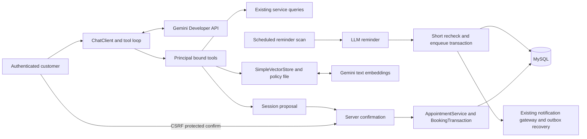

# Milestone 4 implementation notes

## Boundaries

## Decisions

- AI tools receive the authenticated Account from the server. No actor ID or confirmed=true parameter exists in the model schema.
- Book/cancel tools propose frozen actions. Only the separate session/CSRF-bound confirmation endpoint calls the existing write service. An HTTP confirmation returns200, while the underlying ordinary booking endpoint returns201.
- One proposal expires after5minutes. New turns invalidate older proposals; failed turns refresh the browser's history and pending state.
- Keep up to20 user/assistant messages in session. No persistent memory bonus claimed. Session synchronization assumes the current single app instance; a horizontally scaled deployment would need shared/locked proposal state.
- RAG uses six hand-written passages, real Gemini text embeddings, and SimpleVectorStore. Lazy ingestion avoids making app startup depend on external API availability. No Chroma container needed.
- LLM generation runs before reminder enqueue transaction; send runs after commit. Event IDs persist in the existing outbox/receipt tables. Reminder generation is not itself a durable queued job.
- The mock accepts APPOINTMENT_REMINDER in addition to the existing book/cancel types. Recovery suppresses reminders no longer upcoming; in-flight HTTP cannot be recalled.
- Scheduler enabled globally with2threads so disabling notification recovery does not disable autonomous AI work, and slow LLM calls do not occupy the only scheduler thread.
- GeminiPublicAnswerModel compensates for SpringAI2.0.2 multipart/thought response representation while preserving tool signatures. Exact upstream adapter tested with local HTTP fixtures.
- AI is optional at startup. Enabling it without a key fails with a clear message. Existing functionality works when AI_ENABLED=false.

## Official references checked November 11 2026

- https://docs.spring.io/spring-ai/reference/getting-started.html
- https://docs.spring.io/spring-ai/reference/api/chat/google-genai-chat.html
- https://docs.spring.io/spring-ai/reference/api/tools.html
- https://github.com/spring-projects/spring-ai/tree/v2.0.2
- https://aistudio.google.com/docs/models/gemini-3.8-flash
- https://aistudio.google.com/docs/embeddings

The report describes required functionality. Optional bonus items are not represented as completed live model demonstrations.
